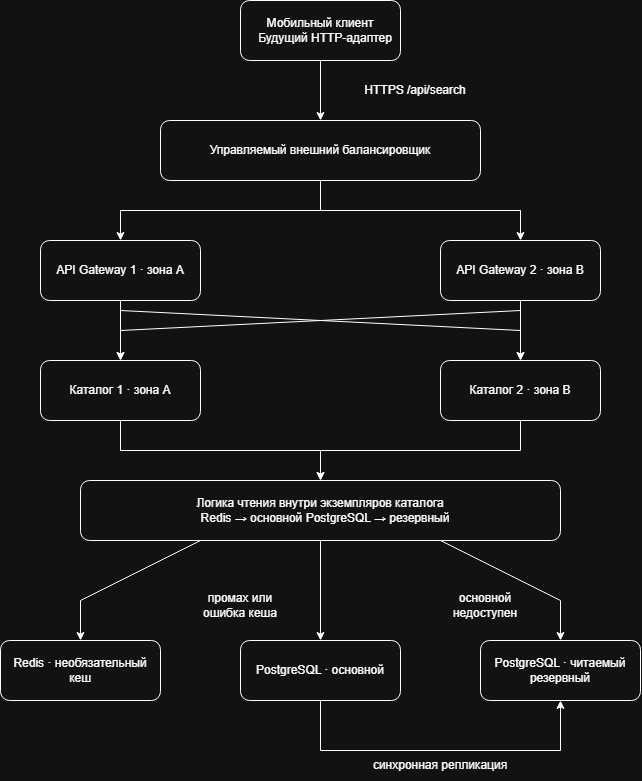
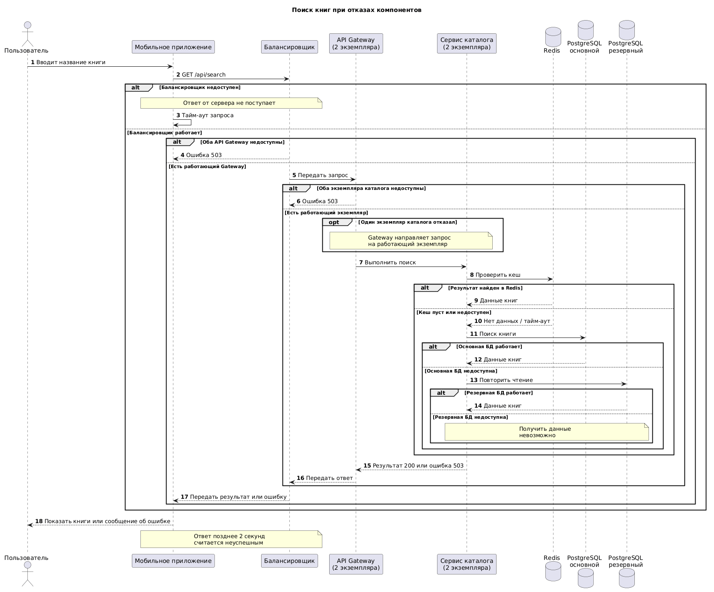

# Разработка плана отказоустойчивости и надёжности распределённой системы

**Критический процесс:** «Поиск книг в электронном каталоге мобильного приложения Author.Today».

Приложение позволяет искать и читать книги, просматривать карточки и вести библиотеку. Клиент использует JavaScript, Expo SDK 58, React Native и Expo Router; настройки хранятся в AsyncStorage. Поиск проходит через `SearchPanel` и экран `results` к функциям `searchCatalog` и `searchAll`. Это подтверждают [catalog.js](../src/services/catalog.js), [mockApi.js](../src/services/mockApi.js) и [package.json](../package.json). Каталог берётся из локальных JavaScript-данных, HTTP-запросов к серверу нет. Далее рассматривается предлагаемая серверная архитектура; все показатели — цели, а не результаты испытаний. Открытие карточки книги в основной SLI не входит.

Серверная часть включает отказоустойчивый балансировщик, два API Gateway и минимум два экземпляра сервиса каталога. Gateway и каталог предполагается запускать контейнерами на разных узлах в двух зонах доступности. Балансировщик распределяет запросы между Gateway, а Gateway направляет поиск к доступной копии каталога.

PostgreSQL хранит каталог книг. Основной и читаемый резервный узлы используют синхронную репликацию [1]. При отказе основного поиск обращается к резервному. Redis хранит готовые результаты повторяющихся запросов. Если кеш пуст или недоступен, каталог читает БД. Поэтому отказ Redis сам по себе не останавливает поиск.

## 1 Сценарии атрибутов качества

### 1.1 Availability при отказе компонента

| Элемент | Сценарий |
| --- | --- |
| Источник стимула | Оборудование или операционная система сервера. |
| Стимул | Отказывает один экземпляр каталога либо основной PostgreSQL. |
| Артефакт | Сервис поиска и его база данных. |
| Среда | 50 запросов/с; второй каталог и резервная БД исправны. Два варианта отказа проверяются отдельно. |
| Реакция | Gateway выбирает другой каталог. При отказе основной БД каталог читает резервную. Неисправный компонент восстанавливается. |
| Мера реакции | Восстановление обслуживания ≤ 5 с. За 10 минут — ≤ 30 ошибок из 30 000 запросов. Успешный ответ приходит не позднее 2 с. |

Во время переключения поиск должен продолжаться через резерв. Полная остановка на 5 с дала бы 250 ошибок и нарушила ограничение 30 ошибок. Поэтому время восстановления и время отдельного ответа проверяются вместе.

### 1.2 Scalability при росте нагрузки

| Элемент | Сценарий |
| --- | --- |
| Источник стимула | Пользователи, одновременно выполняющие поиск. |
| Стимул | Нагрузка растёт с 50 до 250 запросов/с на 10 минут. |
| Артефакт | Gateway, экземпляры каталога, Redis и PostgreSQL. |
| Среда | Два работающих экземпляра каталога; остальные компоненты исправны. |
| Реакция | Число экземпляров увеличивается с двух до четырёх. Запросы распределяются между ними; Redis уменьшает повторные чтения БД. |
| Мера реакции | Четыре экземпляра готовы не позднее 2 минут. За 10 минут — ≤ 150 ошибок из 150 000 запросов. Успешный ответ приходит не позднее 2 с. |

Два исходных экземпляра должны выдерживать пик до запуска дополнительных копий. БД также должна справляться с пиковой нагрузкой: увеличение числа каталогов не устраняет перегрузку PostgreSQL.

## 2 SLI SLO SLA и бюджет ошибок

### 2.1 SLI успешности поиска

SLI — доля успешных поисковых запросов [2]:

\[
\mathrm{SLI}=\frac{\text{Успешные запросы}}{\text{Все учитываемые запросы}}\times100\%.
\]

Успех — корректный HTTP 200 не позднее 2 с, включая пустой результат поиска. Ответы 5xx, 429, тайм-ауты и некорректные ответы на правильные запросы учитываются как ошибки. HTTP 429 означает отказ в обслуживании и расходует бюджет ошибок. Ошибочный пользовательский ввод и служебные проверки исключаются. Внутренние повторные попытки не считаются новыми запросами.

Учитываются запросы, принятые балансировщиком. Отказ входа до приёма запроса выявляется отдельной проверкой доступности. Если учитываемых запросов нет, SLI не вычисляется.

### 2.2 SLO и бюджет ошибок

SLO — внутренняя цель команды: **99,9% успешных запросов за календарный месяц**. Поиск нужен для доступа к книгам, поэтому небольшой допустимый процент ошибок обосновывает резервирование компонентов.

Бюджет ошибок — сколько запросов могут завершиться неуспешно без нарушения цели. Для 100 000 запросов:

\[
B_{SLO}=100\,000\times(1-0{,}999)=100\text{ ошибок}.
\]

Например, 35 ответов 5xx, 40 тайм-аутов и 25 ответов 429 дают 100 ошибок. Бюджет исчерпан; следующая ошибка нарушит SLO. Это бюджет запросов, а не разрешённое время простоя.

### 2.3 SLA для пользователя

SLA — предлагаемое обязательство перед пользователем поиска: **99,5% успешных запросов за тот же календарный месяц**, по тем же правилам учёта.

\[
B_{SLA}=100\,000\times(1-0{,}995)=500\text{ ошибок}.
\]

Разница SLO и SLA — **0,4 процентного пункта**, или 400 запросов на объёме 100 000. Более строгий SLO позволяет команде заметить проблему раньше нарушения SLA.

Нарушение SLA фиксируется, если месячный SLI ниже 99,5%. Команда сопровождения подтверждает результат по счётчикам запросов, уведомляет пользователей в приложении или на странице состояния, восстанавливает поиск и устраняет причину сбоя. После исправления публикуется сообщение о восстановлении.

## 3 Анализ отказов по диаграмме последовательности

Диаграмма показывает запрос пользователя через мобильное приложение, балансировщик, Gateway и каталог. Для Gateway и каталога предусмотрено по два экземпляра. Исходный код PlantUML [3] сохранён в [search-failure-sequence.puml](search-failure-sequence.puml).

Отказ одной копии Gateway или каталога компенсируется второй. При отказе основной БД используется резервная; отказ Redis обходится чтением БД. Поиск недоступен при отказе входа, обоих каталогов либо при одновременном отсутствии пригодного кеша и доступной БД.

**Заключение**

Резервирование должно сохранить поиск при одиночном сбое, а дополнительные экземпляры — обеспечить работу при росте нагрузки. SLI позволяет проверить выполнение SLO и SLA по ответам системы. Основной результат плана — измеримые условия успешной работы и понятный порядок обработки отказов.

**Допущения и ограничения**

- Рассматриваются одиночные отказы компонентов; полная потеря региона в план не входит.
- 100 000 запросов за месяц — пример расчёта, а не измеренная посещаемость приложения.

**Источники**

1. PostgreSQL. Log Shipping Standby Servers. https://www.postgresql.org/docs/18/warm-standby.html
2. Google SRE. Implementing SLOs. https://sre.google/workbook/implementing-slos/
3. PlantUML. Sequence Diagram. https://plantuml.com/sequence-diagram
